<div align="center">

# Investo

### Where founders and investors close deals

A full-stack fundraising platform that matches startups with investors, explains each match with AI, and gives both sides one place for chat, meetings, data rooms and the deal pipeline.


[Screenshots](#screenshots) · [Features](#features) · [Architecture](#architecture) · [Run it locally](#run-it-locally) · [Deploy it](#deploy-it)

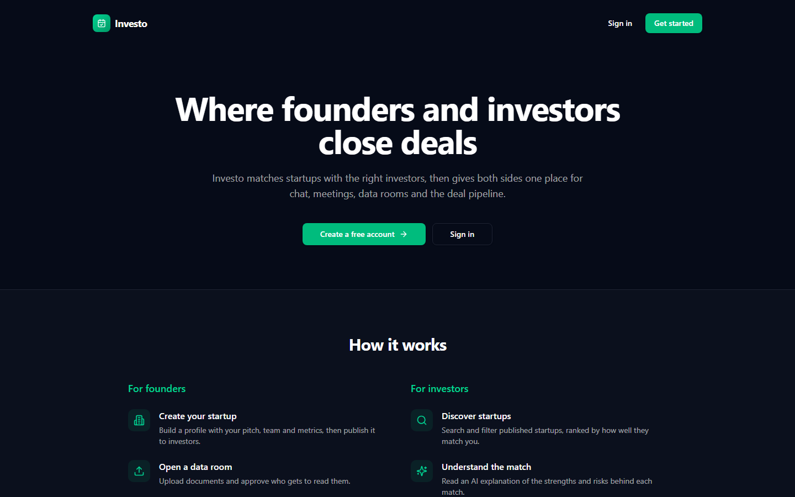

</div>

> [!NOTE]
> This is a college project. **All money is simulated.** Subscriptions use a demo checkout and deals record dummy amounts, so no real payment or investment ever takes place.

## Why Investo

Early fundraising is scattered. Founders chase investors over email, investors can't easily tell which startups fit their thesis, and due diligence happens in shared folders nobody tracks.

Investo brings the whole journey into one product:

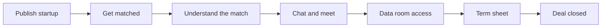

## Screenshots

### For investors

| Ranked matches | AI match explanation |
|---|---|
| 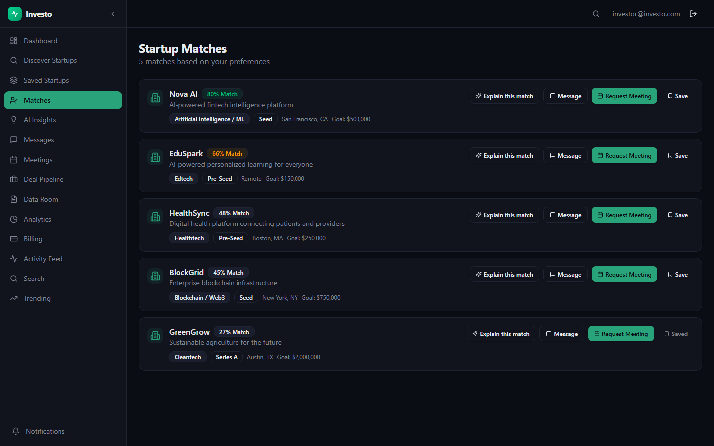 | 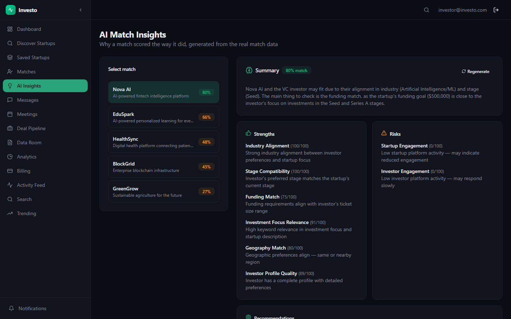 |

| Startup profile with funding progress | Deal pipeline |
|---|---|
| 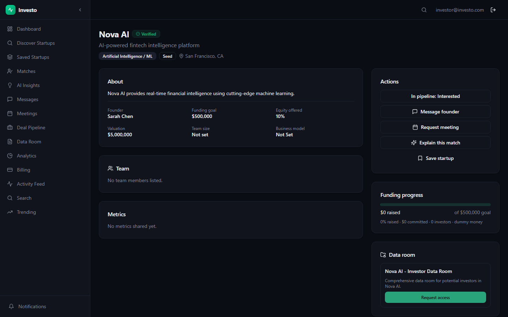 | 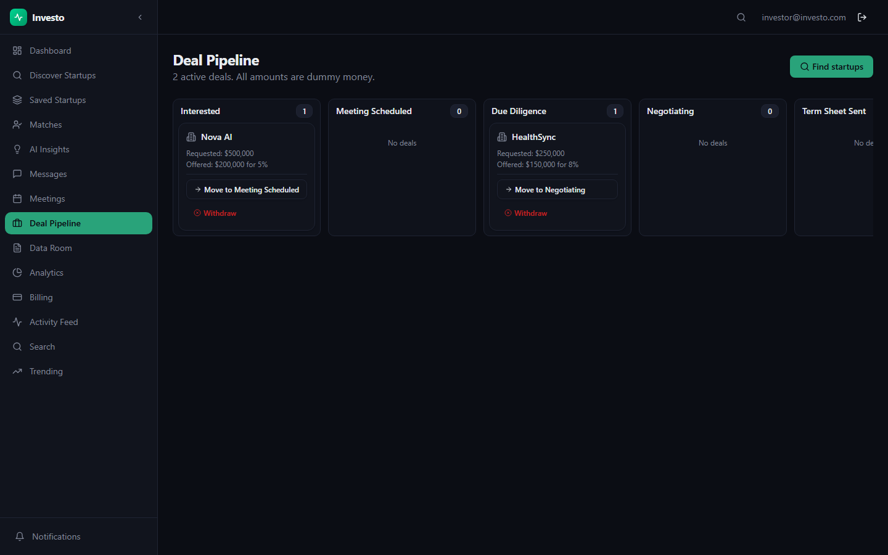 |

### For founders

| Dashboard | Data room and access requests |
|---|---|
| 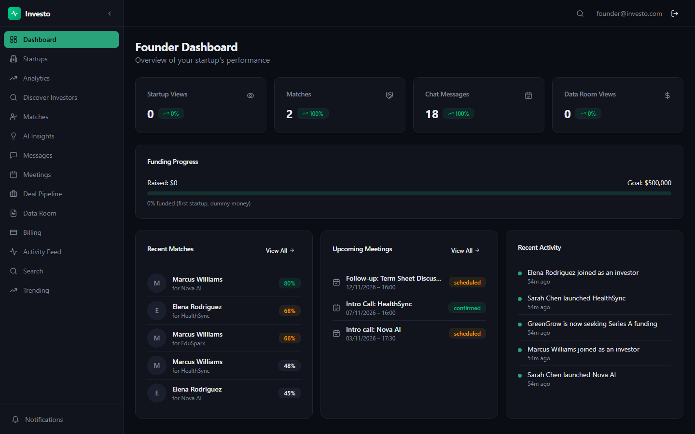 | 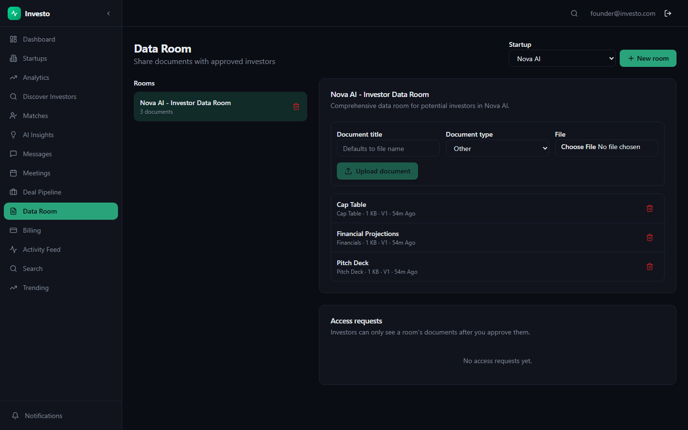 |

### For administrators

| Platform overview |
|---|
| 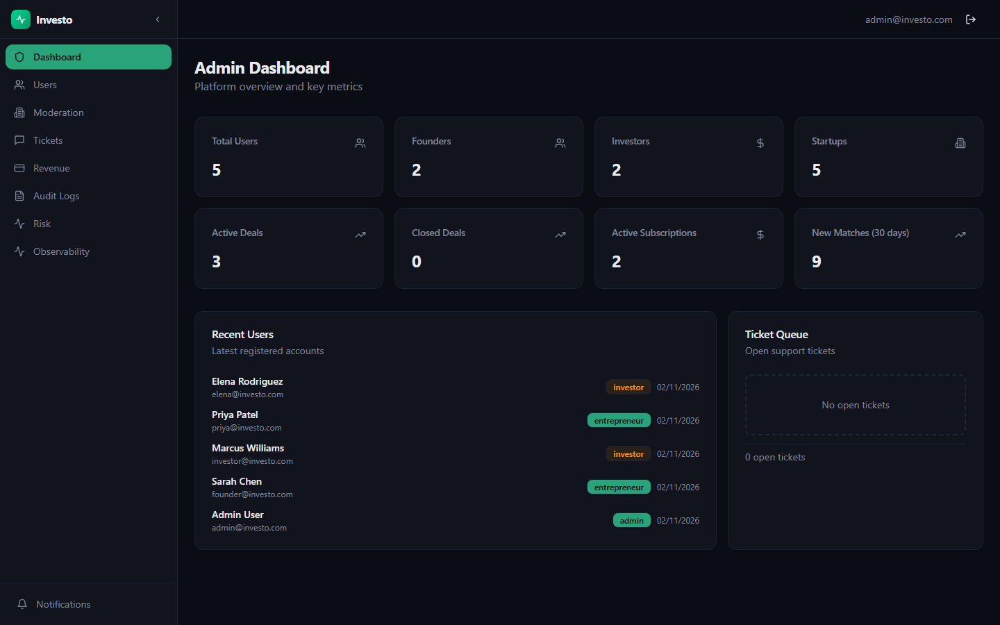 |

More screens are in [`docs/images`](docs/images).

## Features

### Matching and AI

- **Weighted match scoring** across nine factors, including industry, stage, funding, geography and investment focus.
- **AI match explanations** written by a local language model, alongside strengths, risks and recommended next steps.
- **Semantic matching** compares meaning rather than exact words, so an investor focused on "clean energy" can match a startup working on "carbon capture".
- **Private by design:** models run on your own machine through Ollama. If Ollama is off, the app falls back to rule-based explanations and keyword matching.

### Fundraising workflow

- **Deal pipeline board** that moves from interest to meeting, due diligence, negotiation, term sheet and close.
- **Two-sided closing:** a founder must accept the term sheet before an investor can close, and a changed term sheet needs fresh acceptance.
- **Funding progress** for each startup, showing dummy money raised against its goal.

### Collaboration

- **Data rooms with approval:** investors request access, founders approve or deny, and nothing is visible until approved.
- **Chat** between founders and investors.
- **Meeting scheduling** with real [Jitsi](https://meet.jit.si) video links.
- **Notifications and an activity feed** for what's happening across the platform.

### Platform

- **Three roles** with their own dashboards: founder, investor and administrator.
- **Admin console** for users, startup moderation, support tickets, revenue, audit logs, risk and system health.
- **Demo subscriptions** with plans, invoices and a clearly labelled demo checkout.
- **Search and discovery** with filters and a trending view.

## Architecture

### System overview

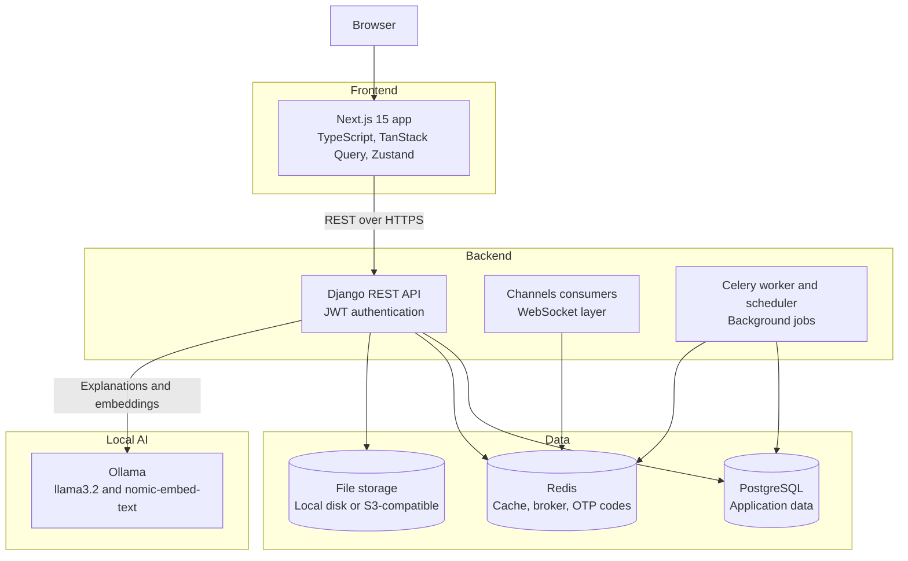

> The frontend currently refreshes chat by polling every 5 seconds. The WebSocket consumers exist on the backend but aren't connected to the frontend yet.

### Backend layers

Every Django app follows the same structure, which keeps business logic testable and separate from HTTP.

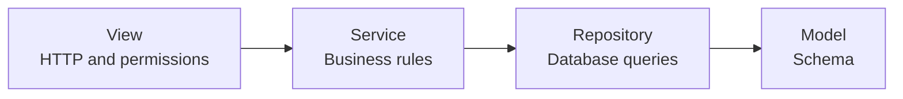

### Deal lifecycle

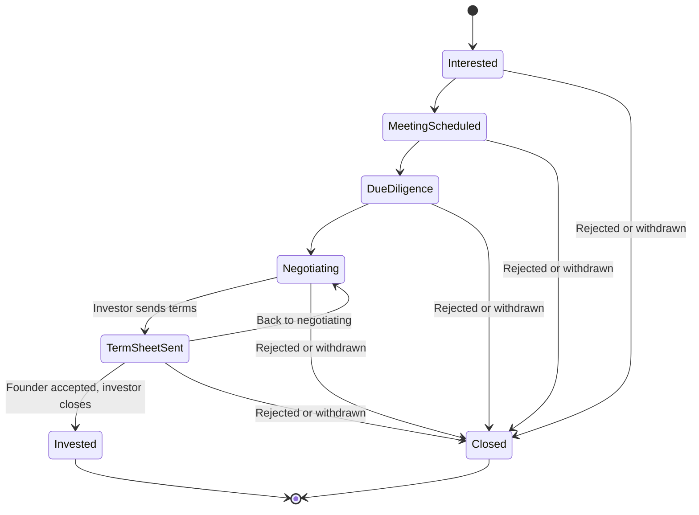

Founders reject deals and investors withdraw from them.

### Data room access

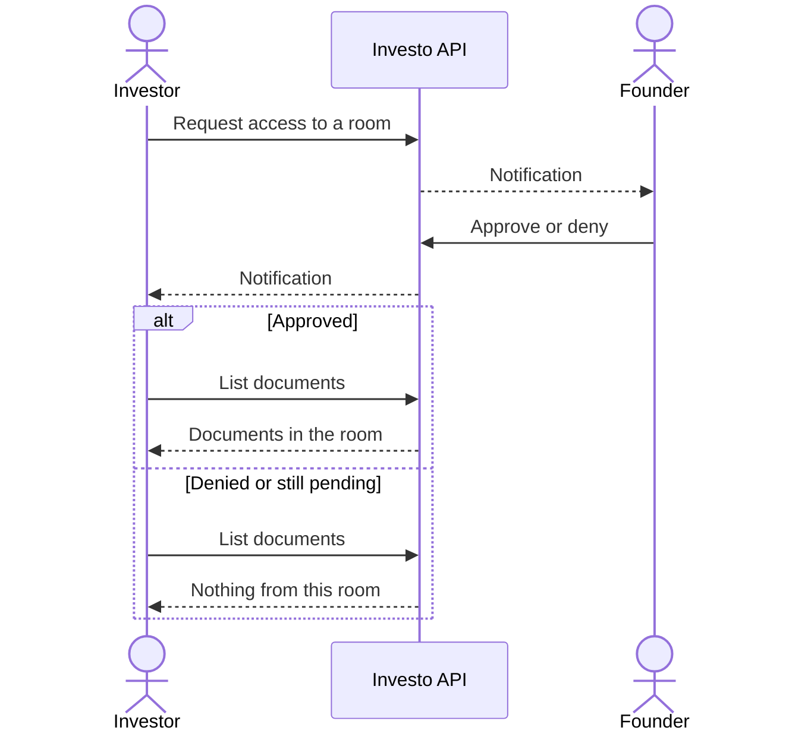

### Core data model

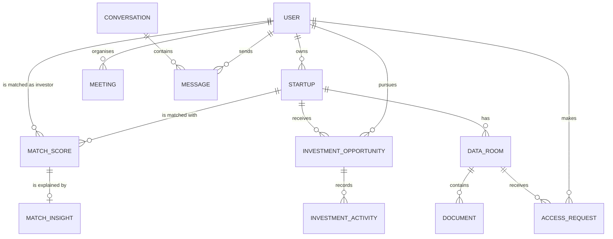

## Tech stack

| Layer | Technology |
|---|---|
| **Frontend** | Next.js 15 (App Router), React 19, TypeScript, Tailwind CSS, Radix UI, TanStack Query, Zustand, Recharts |
| **Backend** | Python 3.12, Django 5, Django REST Framework, SimpleJWT, Channels, Celery |
| **Data** | PostgreSQL, Redis |
| **AI** | Ollama running `llama3.2:3b` for text and `nomic-embed-text` for embeddings |
| **Testing** | pytest, factory_boy, Playwright |
| **Delivery** | Docker Compose, GitHub Actions, Render, Vercel |

## Run it locally

You'll need **Python 3.12**, **Node 22** and **Docker**.

```bash
git clone https://github.com/nithinskumar866/investo-platform.git
cd investo-platform

# 1. Configure: copy the example, then set DJANGO_SECRET_KEY to a long random string
cp .env.example .env

# 2. Start Postgres and Redis
docker compose -f docker/docker-compose.yml up -d postgres redis

# 3. Start the backend
python -m venv .venv
source .venv/bin/activate         # Windows: .venv\Scripts\activate
pip install -r requirements/development.txt
python manage.py migrate
python seed_data.py
python manage.py runserver

# 4. Start the frontend, in a second terminal
cd frontend
cp .env.example .env.local
npm ci
npm run dev
```

Open **http://localhost:3000**.

> [!TIP]
> If port 5432 is already in use, run `POSTGRES_PORT=55433 docker compose -f docker/docker-compose.yml up -d postgres redis` and set `DB_PORT=55433` in `.env`.

### Turn on the AI features (optional)

Install [Ollama](https://ollama.com), then:

```bash
ollama pull llama3.2:3b
ollama pull nomic-embed-text
python manage.py pregenerate_insights --limit 10
```

An explanation can take up to a minute on a laptop CPU, so generate them before a demo. They're saved after the first run.

### Demo accounts

| Role | Email | Password |
|---|---|---|
| Founder | `founder@investo.com` | `founder123` |
| Investor | `investor@investo.com` | `investor123` |
| Admin (local only) | `admin@investo.com` | `admin123` |

On a hosted copy, the admin password is random. Find it in Render under the `DEMO_ADMIN_PASSWORD` environment variable.

### Try the full journey

1. Sign in as a **founder**, then create and publish a startup. Publishing generates investor matches.
2. Create a data room for the startup and upload a document.
3. In a private window, sign in as an **investor** and open the startup from **Discover Startups**.
4. Read the match explanation, then request data room access and express interest.
5. As the founder, approve the access request. The investor can now read the document.
6. As the investor, move the deal through its stages and send a term sheet.
7. As the founder, accept the term sheet.
8. As the investor, close the deal and watch the startup's funding progress update.

## Deploy it

Vercel hosts the frontend, while Render hosts the API, database and Redis. Both have free plans.

### 1. Deploy the backend on Render

[](https://render.com/deploy?repo=https://github.com/nithinskumar866/investo-platform)

[`render.yaml`](render.yaml) creates the API, Postgres and Redis, generates the secrets, runs migrations and loads the demo data. When it's live, copy the service URL, such as `https://investo-api.onrender.com`.

### 2. Deploy the frontend on Vercel

[](https://vercel.com/new/clone?repository-url=https%3A%2F%2Fgithub.com%2Fnithinskumar866%2Finvesto-platform&root-directory=frontend&env=NEXT_PUBLIC_API_URL&envDescription=Your%20Render%20API%20URL%20followed%20by%20%2Fapi%2Fv1)

When prompted, set `NEXT_PUBLIC_API_URL` to your Render URL followed by `/api/v1`, for example `https://investo-api.onrender.com/api/v1`.

### What differs on free hosting

| Area | Behaviour on the free plans |
|---|---|
| **First request** | The API sleeps after about 15 minutes idle, so the first request can take around a minute. |
| **Database** | Render's free Postgres expires after 30 days. [Check their current limits](https://render.com/docs/free). |
| **AI** | Cloud free plans can't run Ollama, so hosted copies use rule-based explanations and keyword matching. |
| **Uploads** | Files live on temporary disk, are lost on redeploy, and anyone with a file's URL can open it. Upload dummy documents only. |
| **Email** | Emails print to the server log, so verification and password reset codes aren't delivered. Use the demo accounts. |
| **Background jobs** | There's no separate worker, so scheduled jobs like daily match refreshes don't run. |

## Testing

```bash
# Backend: needs Postgres and Redis running
DJANGO_SETTINGS_MODULE=config.settings.testing pytest

# End-to-end: needs the backend running with seeded data
cd frontend
npx playwright install chromium
npx playwright test tests/core_journey.spec.ts
```

| Suite | Coverage |
|---|---|
| **Backend** | 930 tests with about 74% line coverage |
| **End-to-end** | 12 browser tests covering the complete founder and investor journeys, login, role guards and admin pages |

## Project structure

```text
investo-platform/
├── apps/                    # Django apps
│   ├── accounts/            # Users, profiles, authentication
│   ├── startups/            # Startup profiles and documents
│   ├── matching/            # Scoring engine and semantic similarity
│   ├── match_intelligence/  # AI match explanations
│   ├── investments/         # Deal pipeline and funding progress
│   ├── data_room/           # Rooms, documents, access requests
│   ├── chat/                # Conversations and messages
│   ├── meetings/            # Scheduling and video links
│   ├── notifications/       # In-app and email notifications
│   ├── activity_feed/       # Platform activity
│   ├── search_app/          # Search and discovery
│   ├── analytics/           # Dashboards and reports
│   ├── billing/             # Demo plans, subscriptions, invoices
│   ├── operations/          # Admin console
│   ├── observability/       # Health checks and metrics
│   ├── onboarding/          # Setup wizard API
│   ├── settings/            # Platform settings and feature flags
│   └── common/              # Shared permissions, throttles, helpers
├── config/                  # Settings, URLs, ASGI and Celery setup
├── frontend/                # Next.js application
│   ├── src/app/             # Pages for each role
│   ├── src/components/      # Shared UI
│   ├── src/hooks/           # API hooks
│   └── tests/               # Playwright tests
├── docker/ · nginx/         # Container and proxy configuration
├── render.yaml              # Backend hosting blueprint
└── seed_data.py             # Demo data
```

## API

The API has almost 200 routes under `/api/v1`, documented in [`schema.yml`](schema.yml). In development, interactive docs are at `http://localhost:8000/api/docs/`.

| Prefix | Purpose |
|---|---|
| `/auth/` | Registration, login, token refresh, password reset, profiles |
| `/startups/` | Startup profiles, documents, funding progress |
| `/matching/` | Matches, preferences and AI explanations |
| `/investments/pipeline/` | Deal stages, term sheets, closing |
| `/data-room/` | Rooms, documents, access requests |
| `/chat/` · `/meetings/` | Conversations and scheduling |
| `/search/` · `/activity/` | Discovery and feeds |
| `/analytics/` · `/billing/` | Dashboards and demo subscriptions |
| `/admin/` · `/ops/` | Admin console and system health |

## Security

- **Authentication:** JWT access tokens last 15 minutes, with refresh token rotation and revocation on logout.
- **One-time codes:** cryptographically random, stored hashed, and destroyed after 5 wrong guesses.
- **Rate limiting:** per-account and per-IP limits on login and code entry.
- **Access control:** role and ownership checks on private startup data, deals and platform analytics.
- **Secrets:** read from the environment, and generated automatically on Render.

## Known limitations

This is a demonstration project, not a regulated financial product.

- Real payments, KYC and e-signature are out of scope.
- Chat polls instead of using the WebSocket layer.
- Email verification is available but isn't required to use the app.
- Auth tokens sit in browser `localStorage`, which is acceptable for a demo but not for production.
- Backend type stubs and strict linting aren't enforced yet.

## Roadmap

- [ ] Connect the frontend to WebSockets for live chat and notifications
- [ ] Pitch deck analyzer using the local AI model
- [ ] Due diligence assistant that answers questions from data room documents
- [ ] Analytics with richer charts
- [ ] Permanent cloud file storage
- [ ] Guided onboarding wizard in the frontend
